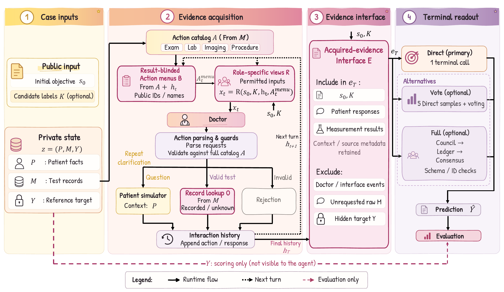

# 🩺 EGIP: An Evidence-Grounded Interaction Protocol for Clinical Agents

[](https://arxiv.org/abs/2610.24539)
[](https://github.com/Nislab-r/EGIP/blob/main/LICENSE)

EGIP controls how clinical agents access information, request examinations, and obtain recorded results. A shared acquired-evidence interface separates evidence acquisition from terminal prediction, allowing different decision strategies to use the same observations.

This repository provides the **MedAgentSim implementation**, with **107 MedQA cases** as a reproduction example. It supports Direct, Vote, and Full.

## 📑 Contents

- [🌟 Overview](#-overview)
- [📦 Installation](#-installation)
- [⚡ Quick Start](#-quick-start)
- [📊 Experiments](#-experiments)
- [📁 Project Structure](#-project-structure)
- [📝 Citation](#-citation)
- [📄 License](LICENSE)
- [🤝 Acknowledgements](#-acknowledgements)

## 🌟 Overview



*Controlled evidence acquisition and decoupled terminal prediction.*

EGIP connects four components along the evidence flow:

1. **Role-specific views (R)** define what each agent can observe.
2. **Result-blinded action menus (B)** expose available examinations without their results.
3. **Record lookup (O)** returns stored findings for valid requests.
4. **Acquired-evidence interface (E)** supplies acquired observations to Direct, Vote, or Full.

See [Integration](docs/integration.md) for the implementation and MedAgentSim adapter.

## 📦 Installation

Use Python 3.10 or 3.11. From the repository root:

```bash
python3 -m venv .venv
source .venv/bin/activate
python -m pip install -e .
```

The MedQA data and required MedAgentSim components are included. No separate framework checkout is needed for EGIP runs.

## ⚡ Quick Start

**Start the model server** in a separate terminal on a CUDA machine with sufficient GPU memory:

```bash
python3 -m venv .venv-server
source .venv-server/bin/activate
python -m pip install 'vllm==0.8.5'
vllm serve Qwen/Qwen3-8B --host 127.0.0.1 --port 8000 \
  --dtype bfloat16 --max-model-len 16384
```

This is a reference serving configuration. See [Qwen's deployment guide](https://qwen.readthedocs.io/en/latest/deployment/vllm.html) for other GPU setups.

**Run one case** after the server is ready, from the client environment:

```bash
source .venv/bin/activate
export EGIP_API_BASE=http://127.0.0.1:8000/v1
egip-reproduce --model Qwen/Qwen3-8B --case-ids 0 --repetitions 1 \
  --output results/example
```

For an existing service, change `EGIP_API_BASE` and `--model` to its endpoint and exact served model ID. Set `EGIP_API_KEY` if authentication is required.

## 📊 Experiments

Run EGIP-Direct on all 107 MedQA cases with three repetitions:

```bash
egip-reproduce --model Qwen/Qwen3-8B --output results/medqa_direct
```

The defaults are 19 acquisition rounds followed by terminal prediction, temperature 0.2, 200 output tokens per call, and Qwen3 non-thinking mode. No API seed is set. The same model performs automated scoring with the experiment's MedAgentSim similarity prompt and threshold 0.8.

`results/medqa_direct/summary.json` reports mean accuracy and sample SD. Each `repeat_*/case_*/` stores dialogue, model calls, terminal evidence, and the scored result. Accuracy uses all scheduled cases as the denominator. The paper reports **55.14 ± 0.93%** for this configuration. Results may vary with stochastic generation and serving settings.

Use a separate output directory for each configuration.

### 🧠 Terminal Strategies

Run three repetitions with fresh acquisition:

```bash
egip-reproduce --terminal vote --output results/medqa_vote
egip-reproduce --terminal full --output results/medqa_full
```

For comparisons on identical acquired observations, reuse a saved Direct result instead:

```bash
egip-replay --source results/medqa_direct/repeat_1/case_0000/result.json \
  --model Qwen/Qwen3-8B --terminal vote \
  --first-direct results/medqa_direct/repeat_1/case_0000/result.json \
  --score --dataset MedQA --case-id 0 --output results/vote_case0
```

Vote uses five samples, including the saved Direct answer when `--first-direct` is provided. For Full, change `--terminal` to `full` and omit `--first-direct`. Without `--score`, fixed-evidence prediction returns an answer without automated scoring.

### 📂 Outputs and Native Baseline

`failure.json` records errors. `egip-summarize results/medqa_direct/repeat_1` summarizes a single acquisition run. Pass multiple repetition directories to obtain their mean and sample SD.

The bundled MedAgentSim subset runs EGIP. To execute the original native doctor workflow, use a complete compatible MedAgentSim checkout with its dependencies:

```bash
egip-native --root /path/to/full/MedAgentSim -- <native arguments>
```

Native arguments and transport settings are passed through unchanged. See [Integration](docs/integration.md) for the external checkout interface.

## 📁 Project Structure

```text
.
├── assets/                       # Framework diagram (PNG and PDF)
├── egip_aligned/
│   ├── engine.py                  # Acquisition loop and evidence interface
│   ├── context_engineering.py     # Role-specific views and prompts
│   ├── protocol.py                # Action catalog and observation utilities
│   ├── planner.py                 # Result-blinded action menus
│   ├── actions.py                 # Request handling and record lookup
│   ├── terminals.py               # Direct and Vote
│   ├── finalizer.py               # Full terminal procedure
│   ├── hosts.py                   # MedAgentSim adapter
│   ├── ablations.py               # Acquisition and terminal-input interventions
│   ├── run.py                     # Acquisition and terminal prediction
│   ├── replay.py                  # Prediction on saved evidence
│   ├── reproduce.py               # Repeated MedQA experiments
│   ├── summarize.py               # Accuracy summaries
│   └── _medagentsim/
│       ├── medsim/                # Scenario API, model client, and scorer
│       └── datasets/_medqa.jsonl  # 107-case reference dataset
├── docs/integration.md           # MedAgentSim integration
├── tests/                        # Automated tests
├── pyproject.toml
├── LICENSE                       # Apache License 2.0 for EGIP-authored code
├── NOTICE
└── THIRD_PARTY_NOTICES.md
```

## 📝 Citation

If you use EGIP in your research, please cite:

```bibtex
@misc{ren2026egipevidencegroundedinteractionprotocol,
      title={EGIP: An Evidence-Grounded Interaction Protocol for Clinical Agents}, 
      author={Zecheng Ren and Ruichen Cong and Yi Min Chen and Jing Zhang and Feiyang Chen and Wutong Zhang and Kaixiang Wang and Zihan Wang and Jiong Lou and Jie LI and Qun Jin},
      year={2026},
      eprint={2610.24539},
      archivePrefix={arXiv},
      primaryClass={cs.CL},
      url={https://arxiv.org/abs/2610.24539}, 
}
```

## 🤝 Acknowledgements

We thank the authors of [MedAgentSim](https://github.com/MAXNORM8650/MedAgentSim) and [AgentClinic](https://github.com/samuelschmidgall/agentclinic) for making their clinical-agent frameworks available. This release uses MedAgentSim's adapted MedQA cases. See [THIRD_PARTY_NOTICES.md](THIRD_PARTY_NOTICES.md) for source attribution and license terms.
